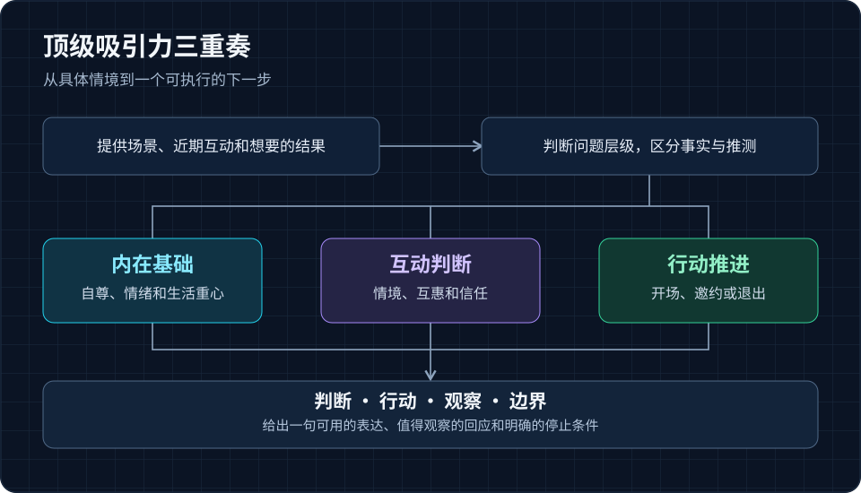
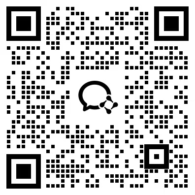
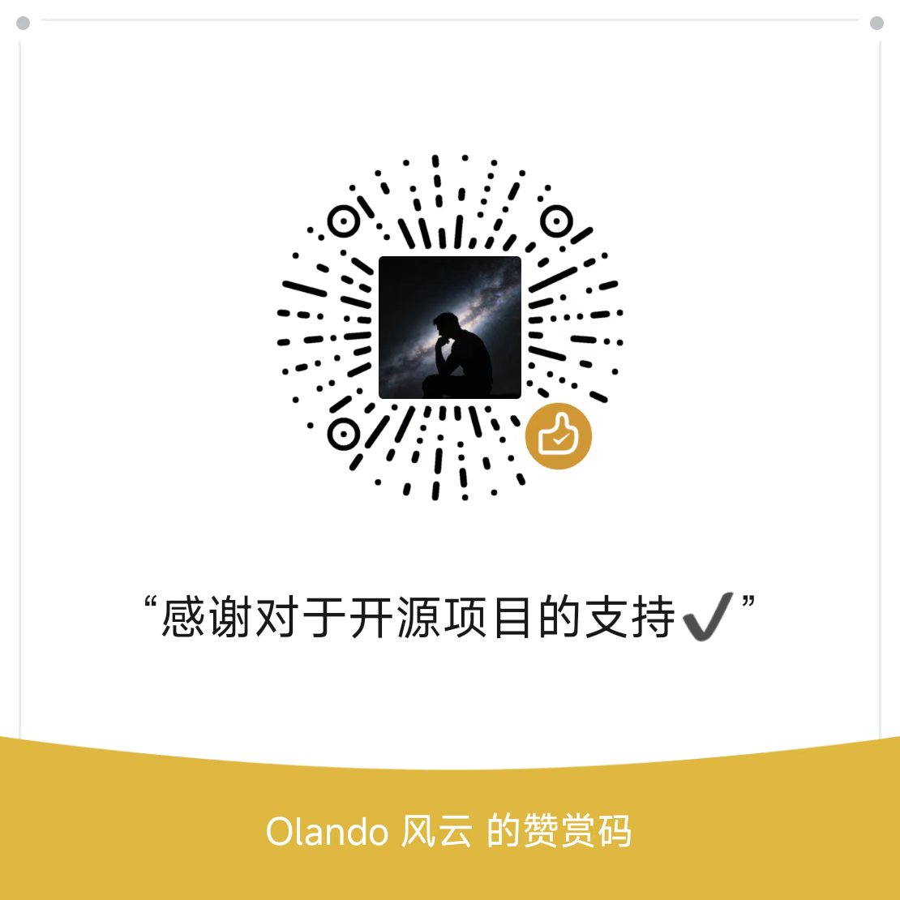

<h1 align="center">顶级吸引力三重奏</h1>

<p align="center">
  <b>帮你理清成人约会中的互动信号，想清楚下一步怎么说、怎么做</b><br>
  <sub>内在基础 · 互动判断 · 行动推进</sub>
</p>

<p align="center">
  <a href="LICENSE.md"></a>
  
  <a href="https://github.com/duliangkuan/attraction-mastery-framework/commits/main"></a>
  <a href="https://github.com/duliangkuan/attraction-mastery-framework/stargazers"></a>
</p>

<p align="center">
  <a href="#这是什么">这是什么</a> ·
  <a href="#架构">架构</a> ·
  <a href="#快速开始">快速开始</a> ·
  <a href="#使用示例">使用示例</a> ·
  <a href="#-关于作者">关于作者</a> ·
  <a href="#-公众号--个人微信--交流群--支持作者">联系与支持</a>
</p>

## 这是什么

认识了一个人，聊得挺好，却拿不准要不要约见面。又或者见过几次，最近回复变慢，你想知道该问一句还是先停下来。把发生过的事告诉 Skill，它会帮你梳理已知事实和可能的解释，再给一个具体的下一步。

| 你遇到的情况 | Skill 如何帮你 |
| --- | --- |
| 想认识对方、发出邀约或准备第一次约会 | 给一句自然的表达，留出让对方选择的空间 |
| 拿不准对方有没有兴趣 | 根据双方实际投入和近期互动梳理线索，指出还缺哪些信息 |
| 等消息时反复内耗，或被拒绝后不知道怎么办 | 找出自己能做的一步，并明确什么时候结束联系 |
| 想确认关系或聊清相处节奏 | 帮你把自己的想法说清楚，再给对方表达意愿的机会 |

## 架构

[](docs/architecture@2x.png)

Skill 先看问题卡在哪一层，再按需读取参考资料。双方意愿与停止条件贯穿整个过程。

## 快速开始

选你使用的客户端执行一条命令。

```bash
# Codex
git clone https://github.com/duliangkuan/attraction-mastery-framework.git ~/.agents/skills/attraction-mastery-framework

# Claude Code
git clone https://github.com/duliangkuan/attraction-mastery-framework.git ~/.claude/skills/attraction-mastery-framework
```

Windows PowerShell 用以下命令。

```powershell
# Codex
git clone https://github.com/duliangkuan/attraction-mastery-framework.git "$env:USERPROFILE\.agents\skills\attraction-mastery-framework"

# Claude Code
git clone https://github.com/duliangkuan/attraction-mastery-framework.git "$env:USERPROFILE\.claude\skills\attraction-mastery-framework"
```

安装后打开新会话。Codex 中输入 `$attraction-mastery-framework`，Claude Code 中输入 `/attraction-mastery-framework`，然后带上你的问题。已经用 Git 安装过的读者，可以在对应的安装目录执行 `git pull --ff-only`。安装目录说明见 [Codex 文档](https://developers.openai.com/api/reference/cli)和 [Claude Code 文档](https://code.claude.com/docs/en/skills)。

## 使用示例

> 我们认识两周，上周一起喝过咖啡。后来她主动分享了一家书店，我想约她周末一起去。帮我判断现在适不适合约，再给我一句自然的邀约。

一次可能的回答如下。

> **判断**　你们已经见过面，她也主动分享了一个话题，可以顺着聊下去。她愿不愿意再见面，要看她对邀约的回应。
>
> **行动**　「你上次发的那家书店我也挺想去的。你周日下午有空一起逛逛吗？」
>
> **观察**　如果她说周日有事但主动提了别的时间，就沿着那个时间聊。如果她只说最近很忙，先给她空间。
>
> **边界**　收到明确拒绝就结束邀约。连续两次具体邀约都没被接受，且对方没有提出其他时间，也停止推进。

## 目录

| 文件 | 用途 |
| --- | --- |
| [SKILL.md](SKILL.md) | Skill 入口、处理流程和输出格式 |
| [references/framework.md](references/framework.md) | 三层框架与判断要点 |
| [references/scenarios.md](references/scenarios.md) | 开场、邀约、约会、回复变慢、被拒绝等场景 |
| [references/sources-and-boundaries.md](references/sources-and-boundaries.md) | 来源、适用边界与公开传播说明 |
| [agents/openai.yaml](agents/openai.yaml) | Codex 界面元数据 |

## 来源与使用边界

三层结构受 Mystery、Robert Greene 和 Owen Cook 的公开作品启发，作为成年人约会与关系沟通的实践参考。早期版本借助花叔的「女娲 · Skill 造人术」生成，公开版由风云重新编辑与维护。公开版以真诚表达、双向选择和明确同意为原则。分享实际案例时，请先去除姓名、联系方式等可识别信息。[来源与使用边界](references/sources-and-boundaries.md) · [女娲 · Skill 造人术](https://github.com/alchaincyf/nuwa-skill)

## 🤝 关于作者

**风云**，公众号「研究 Agent 的云」主理人，分享 Agent 工作流与自用 Skill。欢迎通过 Issue 反馈具体场景，或提交 PR 改进示例。[GitHub 主页](https://github.com/duliangkuan) · [项目 Issues](https://github.com/duliangkuan/attraction-mastery-framework/issues)

## 📱 公众号 · 个人微信 · 交流群 · 支持作者

<table align="center">
  <tr>
    <th align="center">关注公众号</th>
    <th align="center">加个人微信</th>
    <th align="center">加交流群</th>
    <th align="center">赞赏支持</th>
  </tr>
  <tr>
    <td></td>
    <td></td>
    <td></td>
    <td></td>
  </tr>
  <tr>
    <td align="center"><sub>研究 Agent 的云</sub></td>
    <td align="center"><sub>FengYunAgent · 备注 GitHub</sub></td>
    <td align="center"><sub>群活码 · 不定期更新</sub></td>
    <td align="center"><sub>请作者喝杯咖啡</sub></td>
  </tr>
</table>

## 📜 License

Copyright © 2026 风云（GitHub 用户名 `duliangkuan`）。

仓库原创文本采用 CC BY-NC-SA 4.0。署名后可非商业分享和改编，改编作品须以相同许可发布，商业使用需另行授权。第三方作品和名称的权利归各自权利人所有。[完整许可说明](LICENSE.md)
